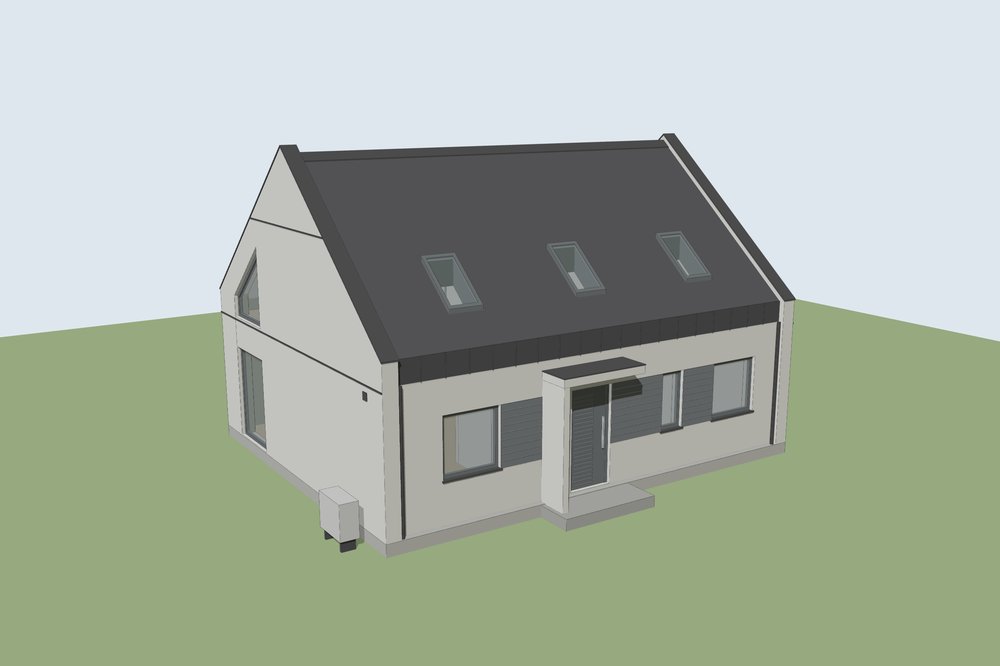
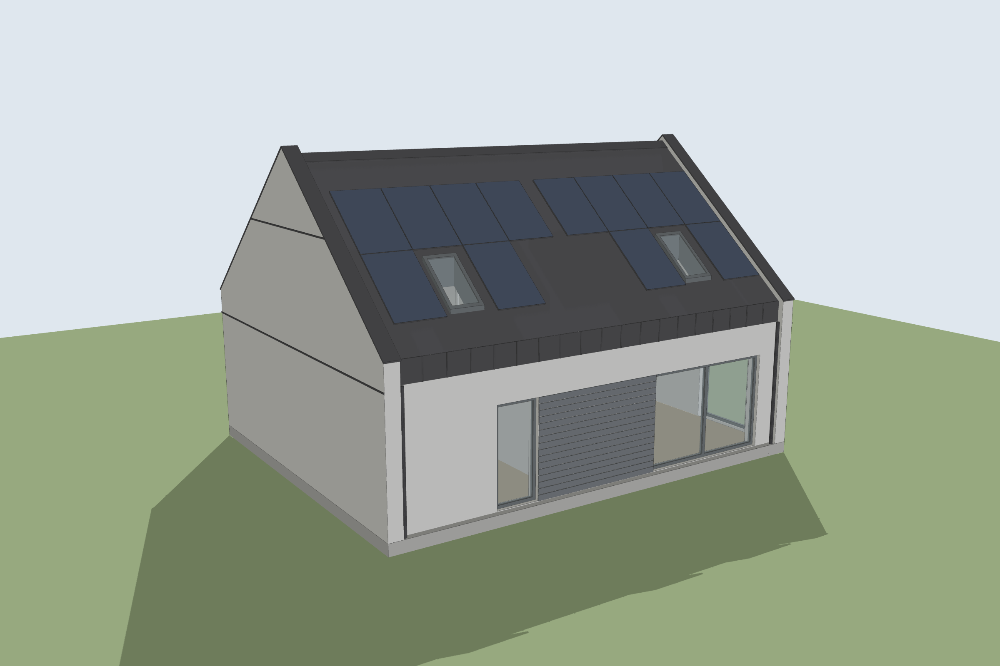
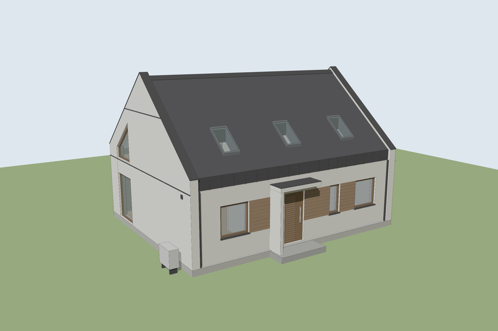
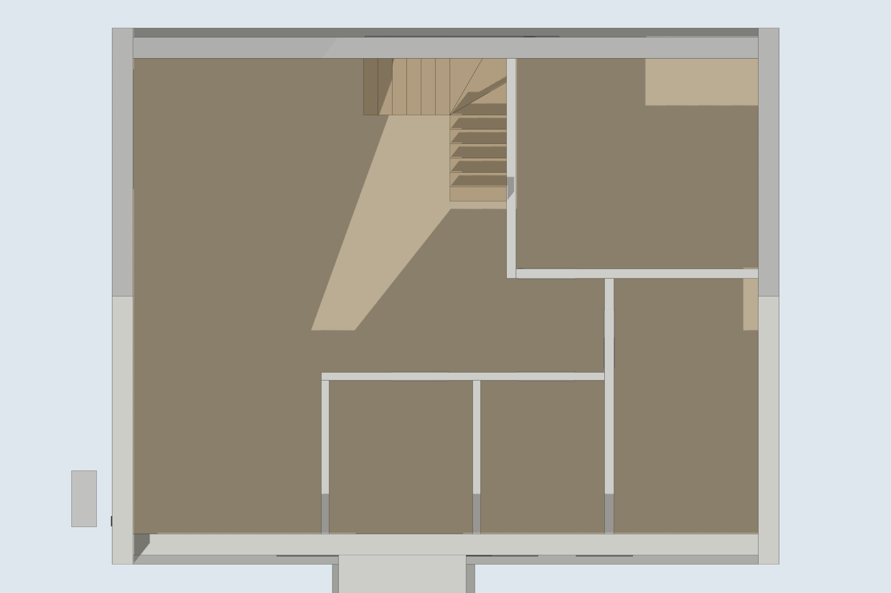
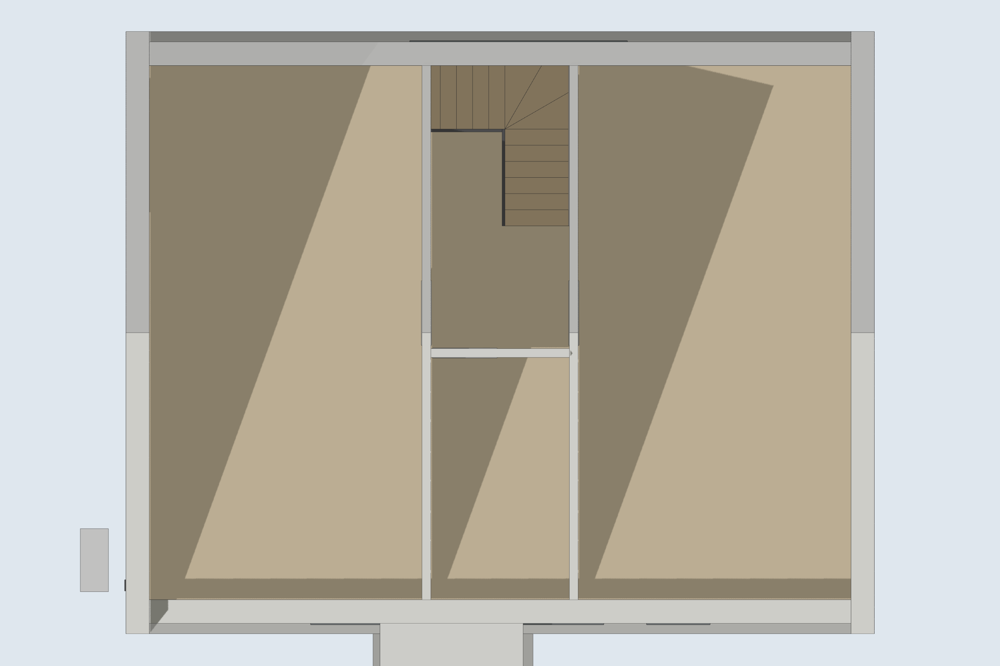
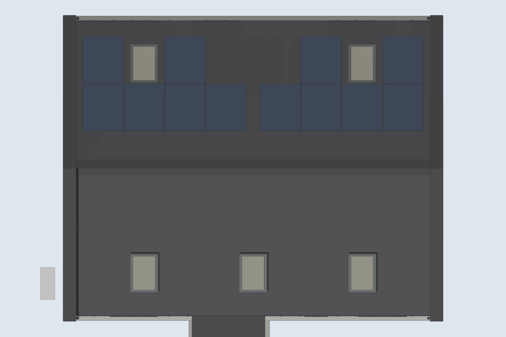

# Dom „Smart comfort+” – model 3D do SketchUpa

Model 3D domu jednorodzinnego **„Smart comfort+” (SENDOM Domy Drewniane, projekt 01.2025)**
zbudowany na podstawie rysunków: rzutu parteru i poddasza, rzutu dachu, przekrojów A-A i B-B,
elewacji oraz zestawienia stolarki.

> Osobny model **garażu (części gospodarczo-garażowej)** jest w folderze [`garaz/`](garaz/README.md),
> a model **perkusji Mapex Mars** do wstawienia w dom – w folderze [`perkusja/`](perkusja/README.md).



| Ogród – antracyt | Front – brąz (Nordika / orzech) |
|---|---|
|  |  |

| Rzut parteru | Rzut poddasza | Dach z fotowoltaiką |
|---|---|---|
|  |  |  |

## Pliki

| Plik | Do czego |
|---|---|
| `sketchup/dom_smart_comfort.rb` | **Główny plik.** Skrypt, który buduje cały model w SketchUpie (natywne grupy, komponenty, tagi, materiały, sceny). |
| `sketchup/dom_smart_comfort_antracyt.dae` | Gotowy model do importu (COLLADA), wariant antracytowy. |
| `sketchup/dom_smart_comfort_braz.dae` | To samo w wariancie brązowym (deska 1806 Nordika, stolarka orzech). |
| `inne_programy/*.glb` | Model w formacie glTF dla innych darmowych programów (Blender, przeglądarki 3D online). |
| `inne_programy/*.obj` + `.mtl` | Model w formacie OBJ (FreeCAD, Sweet Home 3D, Blender i inne). Plik `.mtl` z kolorami musi leżeć obok `.obj`. |
| `podglad/` | Rendery podglądowe. |
| `tools/` | Narzędzia do testowania skryptu poza SketchUpem (opis niżej). |

## Jak wczytać model do SketchUpa

### Sposób 1 – skrypt Ruby (zalecany)

Wymaga **desktopowego** SketchUpa: Pro, 7-dniowej wersji próbnej Pro albo starego darmowego
SketchUp Make 2017. Darmowa wersja przeglądarkowa (SketchUp Free) nie ma konsoli Ruby.

1. Pobierz plik `sketchup/dom_smart_comfort.rb`.
2. W SketchUpie otwórz nowy, pusty model (szablon w centymetrach albo metrach).
3. Menu **Okno → Konsola Ruby** (*Window → Ruby Console*).
4. Wpisz polecenie ze ścieżką do pobranego pliku i naciśnij Enter, np.:

   ```ruby
   load 'C:/Users/Ja/Downloads/dom_smart_comfort.rb'
   ```

   (na Macu np. `load '/Users/ja/Downloads/dom_smart_comfort.rb'`; w Windows używaj ukośników `/`).
5. Po kilku sekundach pojawi się grupa **„Dom Smart comfort+”**. Całość cofa jedno `Ctrl+Z`.
6. Zapisz model jako `.skp`. Taki plik otworzysz potem także w darmowym SketchUp Free.

### Sposób 2 – import pliku .dae

**Plik → Importuj** (*File → Import*) → typ *COLLADA (\*.dae)* → wybierz plik `.dae`.
W opcjach importu zaznacz **„Scal współpłaszczyznowe ściany”** (*Merge coplanar faces*).
Import .dae działa w SketchUp Pro i Make 2017; w wersji webowej tylko w płatnym planie (np. SketchUp Go) – darmowa SketchUp Free importuje wyłącznie .skp, .jpg i .png.
Model z .dae to sama geometria z kolorami. Komponenty, tagi i sceny daje tylko sposób 1.

## Bez SketchUpa – inne darmowe programy (także na Linuksie)

* **Tylko obejrzeć**: przeglądarka 3D online, np. [3dviewer.net](https://3dviewer.net). Przeciągnij na stronę
  plik `inne_programy/dom_smart_comfort_antracyt.glb`.
* **Oglądać i edytować**: [Blender](https://www.blender.org) (darmowy, Windows/macOS/Linux):
  *File → Import → glTF 2.0 (.glb/.gltf)* i wybierz plik `.glb`. Model ma prawdziwe wymiary w metrach.
* **Program CAD**: [FreeCAD](https://www.freecad.org): *Plik → Importuj* i wybierz plik `.obj`.
* **Projektowanie wnętrz**: [Sweet Home 3D](https://www.sweethome3d.com): *Meble → Importuj mebel*
  i wybierz plik `.obj` (bryła domu wczyta się jako jeden obiekt).

W tych formatach są geometria, kolory i nazwy elementów (ściany, dach, okna…), ale bez tagów i scen SketchUpa.

## Co jest w modelu

* **Bryła**: 1066,5 × 829 cm (ściany szczytowe wysunięte 15 cm przed elewacje
  i ponad dach, tzw. „płetwy”). Dach dwuspadowy 40°, kalenica +6,91, okap ok. +3,43,
  posadzka poddasza +2,94, teren −0,29.
* **Ściany**: zewnętrzne 33,5 / 33,2 cm, działowe 12,5–15 cm. Układ pomieszczeń wg rzutów:
  salon z aneksem, wiatrołap, łazienka, pokój 1 i 2 na parterze, dwa pokoje, łazienka i klatka
  schodowa na poddaszu.
* **Stolarka** jako komponenty o nazwach z zestawienia: O1 (×2), O2, Ot1 (HS 320×220), Ot2, W1,
  W2 (trapezowe w szczycie), OP (5 okien dachowych 78×140), DZ (drzwi wejściowe z lamelami),
  D1 (×5) i D2 (×2) – drzwi wewnętrzne.
* **Elewacja**: tynk biały, deska elewacyjna, blachodachówka RAL 9005, pas okapowy z blachy na
  rąbek stojący, opierzenia szczytów, rury spustowe, parapety, daszek nad wejściem, podest,
  jednostka zewnętrzna pompy ciepła, czerpnia.
* **Wnętrze**: posadzki, strop z otworem na schody, schody zabiegowe 16 × 18,4 cm, balustrada.
* **Fotowoltaika**: 12 paneli 1722×1134 mm na połaci ogrodowej, rozmieszczonych wg rzutu dachu.

### Tagi (warstwy)

Teren · Fundament · Ściany szczytowe · Ściany zewnętrzne · Dach · Obróbki blacharskie ·
Okna i drzwi zewnętrzne · Okna dachowe · Elewacja – deska · Detale zewnętrzne · Fotowoltaika ·
Parter – wnętrze · Strop nad parterem · Poddasze – wnętrze

Wyłączając tagi, możesz np. „zdjąć” dach i strop i zajrzeć do środka.

### Sceny

Widok 3D – front · Widok 3D – ogród · Elewacja frontowa · Elewacja ogrodowa ·
Elewacja boczna (W1) · Rzut parteru · Rzut poddasza

## Ustawienia skryptu

Na początku pliku `dom_smart_comfort.rb` jest sekcja **USTAWIENIA**:

```ruby
@wariant      = :antracyt  # albo :braz (deska 1806 Nordika, stolarka orzech)
@teren        = true       # trawnik wokół domu
@wnetrza      = true       # ściany działowe, stropy, schody, drzwi wewnętrzne
@fotowoltaika = true       # panele PV
@sceny        = true       # gotowe sceny
```

Wszystkie wymiary są w metodzie `wymiary!` i przy poszczególnych elementach, w centymetrach.
Układ współrzędnych: oś X wzdłuż kalenicy (od szczytu z oknem W1), oś Y od elewacji frontowej
(wejście) w stronę ogrodu, oś Z w górę, 0 = posadzka parteru.

## Dokładność i założenia

Wymiary pochodzą z rysunków. Tam, gdzie rysunki się różnią albo czegoś nie podają, przyjęto:

* okna O1/O2 z parapetem na +0,90 i górą na +2,21 (wg elewacji); otwór O2 ma 131 cm wysokości
  jak O1 (w zestawieniu podano 121, ale ościeżnica O2 ma 130 – to raczej literówka),
* położenie otworów w ścianie frontowej wg łańcucha wymiarów z rzutu parteru (na elewacji są
  przesunięte o kilka cm),
* ściany szczytowe wystają ok. 15 cm ponad pokrycie (wg elewacji i przekroju B-B),
* okna dachowe na wysokości jak na elewacji: dolna krawędź ok. +3,95,
* panele PV leżą rzeczywiście na połaci, więc są „ściśnięte” względem rysunku dachu (tam narysowano
  je bez skrótu perspektywicznego),
* schody, drzwi wewnętrzne i rozmieszczenie ścianek w łazience/wiatrołapie odczytane z rzutów
  z dokładnością do kilku cm; meble nie są modelowane (można je dodać z 3D Warehouse).

To model poglądowy. Nie zastępuje projektu wykonawczego.

## Narzędzia (dla chętnych)

`tools/` pozwala sprawdzić skrypt bez SketchUpa:

* `tools/sketchup_mock.rb` – atrapa Ruby API SketchUpa (tylko potrzebne fragmenty),
* `tools/run_mock.rb` – uruchamia wybrany skrypt (dom albo garaż) na atrapie i zapisuje geometrię do JSON,
* `tools/export_model.py` – sprawdza, czy każda bryła jest zamknięta i ma ściany skierowane na
  zewnątrz, i zapisuje pliki `.dae`,
* `tools/export_inne.py` – zapisuje te same modele jako `.glb` oraz `.obj` + `.mtl`,
* `tools/build.sh` – robi wszystko powyższe dla domu i garażu, w obu wariantach (`pip install mapbox_earcut numpy`),
* `tools/podglad/` – podgląd w three.js i skrypt renderujący obrazy z katalogu `podglad/`.
