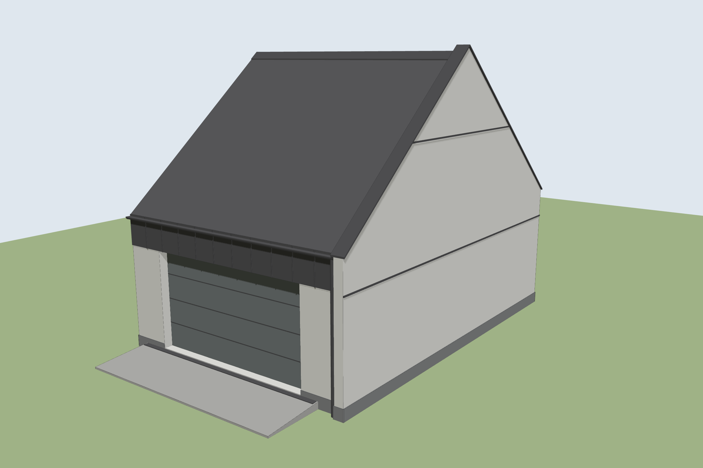
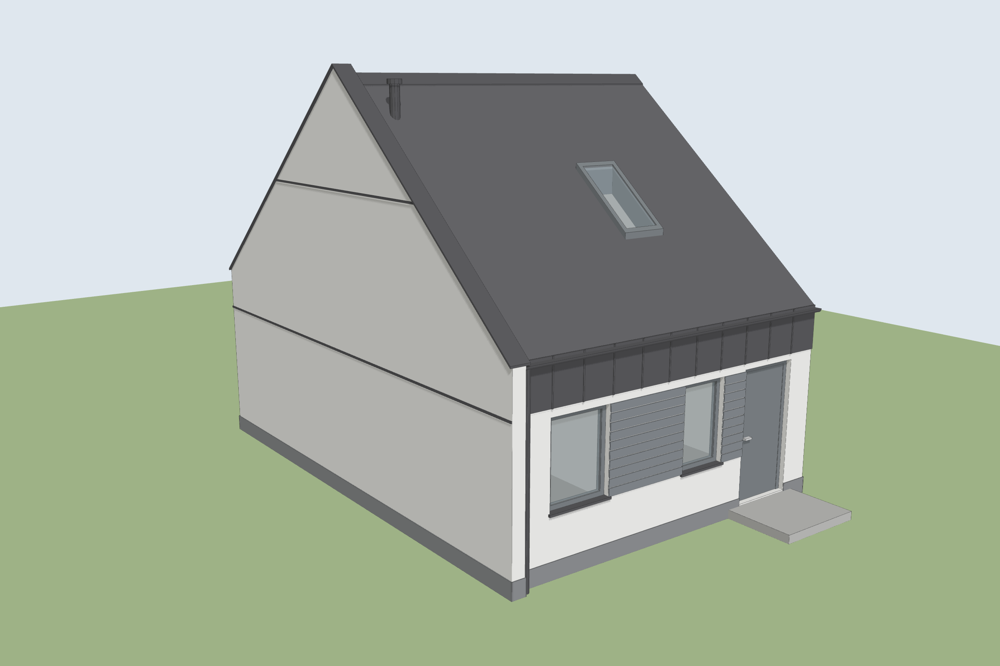
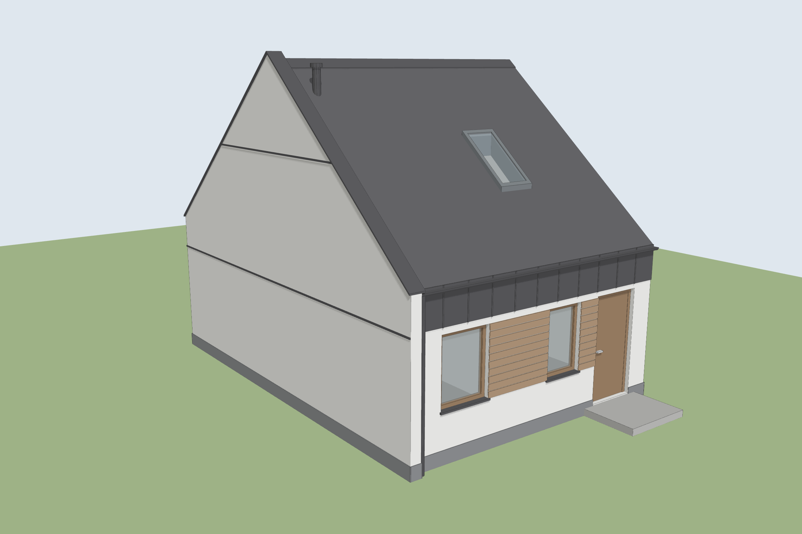
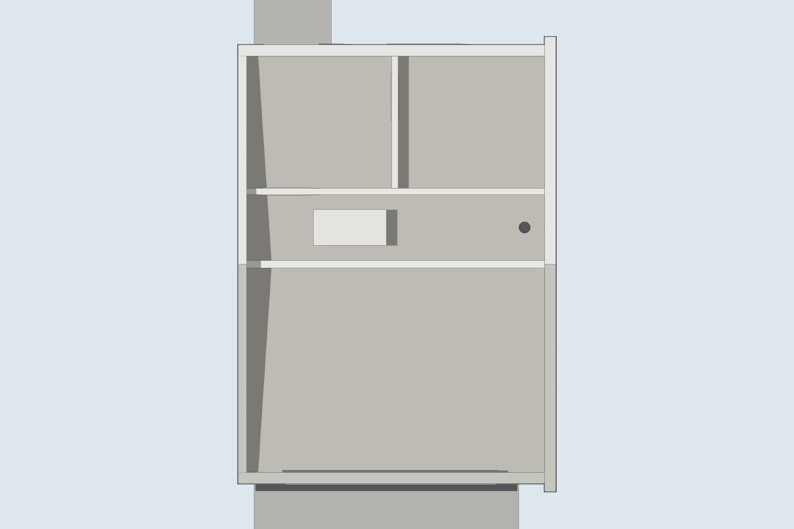
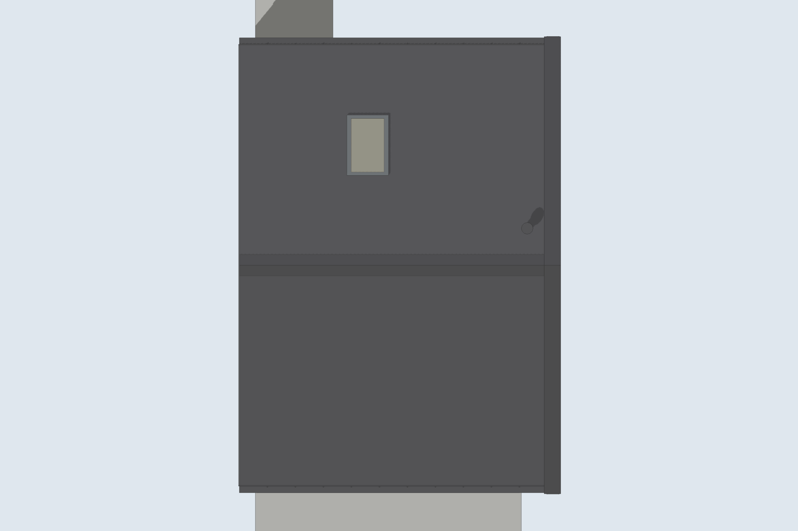
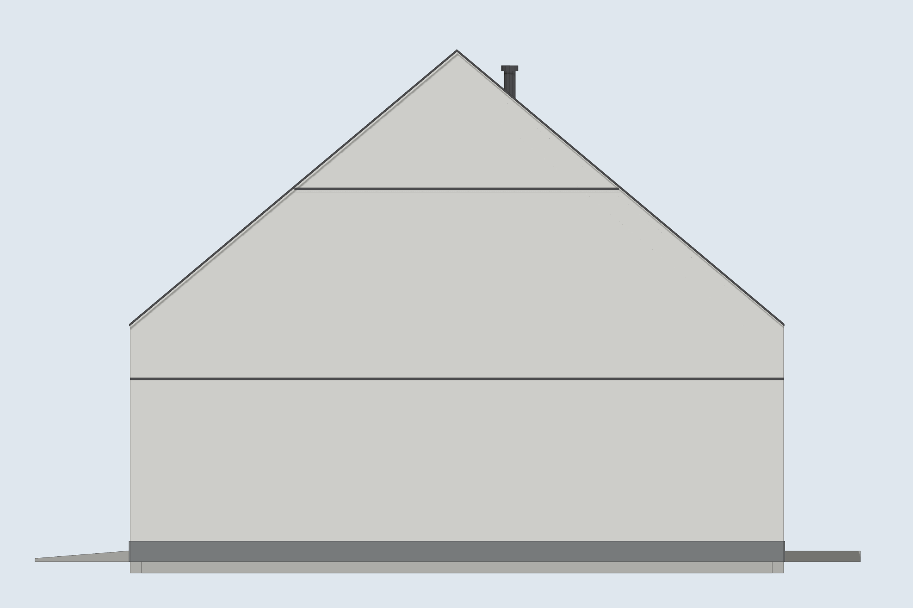

# Garaż – część gospodarczo-garażowa – model 3D

Osobny model budynku gospodarczo-garażowego (bez domu) na podstawie rysunków z 10.2026:
rzutu parteru, rzutu strychu, rzutu dachu, przekroju A-A, elewacji frontowej, ogrodowej
i bocznej prawej oraz zestawienia stolarki. Zrobiony tak samo jak model domu
(opis narzędzi w [README domu](../README.md)).



| Ogród – antracyt | Ogród – brąz (jak brązowy wariant domu) |
|---|---|
|  |  |

| Rzut parteru | Dach | Elewacja boczna |
|---|---|---|
|  |  |  |

## Pliki

| Plik | Do czego |
|---|---|
| `sketchup/garaz.rb` | **Główny plik.** Skrypt budujący model w SketchUpie (grupy, komponenty, tagi, materiały, sceny). |
| `sketchup/garaz_antracyt.dae`, `garaz_braz.dae` | Model do importu w SketchUpie (COLLADA). |
| `inne_programy/garaz_*.glb` | Dla Blendera i przeglądarek 3D online (np. [3dviewer.net](https://3dviewer.net)). |
| `inne_programy/garaz_*.obj` + `.mtl` | Dla FreeCAD, Sweet Home 3D i innych programów (plik `.mtl` musi leżeć obok `.obj`). |
| `podglad/` | Rendery podglądowe. |

## Jak wczytać

* **SketchUp na komputerze**: *Okno → Konsola Ruby* i wpisz
  `load 'C:/ścieżka/do/garaz.rb'`. Model pojawi się jako grupa „Garaż – część gospodarczo-garażowa”.
  Garaż i dom to osobne skrypty, więc można je wczytać do dwóch różnych plików
  albo do jednego i przesunąć garaż na właściwe miejsce.
* **SketchUp z importem .dae** (np. płatna wersja w przeglądarce): *Importuj* plik `.dae`.
* **Blender**: *File → Import → glTF 2.0* i wybierz plik `.glb`, potem naciśnij **Home**
  i włącz podgląd materiałów (*Material Preview*).

## Co jest w modelu

* **Bryła**: 600 × 829 cm, dach dwuspadowy 40°, kalenica +6,30, okap ok. +2,82.
  Prawa ściana szczytowa jest wysunięta 15 cm przed elewacje i 12 cm ponad dach (+6,42),
  z czarną obróbką szerokości 31 cm (jak na rzucie dachu).
* **Poziomy**: ±0,00 = posadzka domu (jak w projekcie), posadzka garażu −0,13, teren −0,29,
  sufit +2,47, podłoga strychu +2,74.
* **Ściany**: zewnętrzne 21 cm, lewa (od strony domu) 16 cm, działowe 12 cm.
  Pomieszczenia: garaż 0.1 oraz pomieszczenia gospodarcze 0.2 i 0.3.
* **Stolarka** (komponenty jak w zestawieniu): BG – brama segmentowa 400×225,
  O1 100×130, O2 80×130, D1 – drzwi zewnętrzne 90×210, D2 (×2) – drzwi wewnętrzne 80×200,
  OP – okno dachowe 78×148.
* **Elewacja**: tynk biały, cokół z tynku mozaikowego grafitowego, deska elewacyjna między oknami,
  pas blachy na rąbek nad bramą i oknami, rynny Ø120 i rury spustowe Ø90, parapety,
  pasy blachy na ścianie szczytowej, wywiewka na dachu.
* **Otoczenie**: podjazd przed bramą ze spadkiem 8% i odwodnieniem liniowym, podest przy drzwiach D1.
* **Wnętrze**: posadzka z gresu, strop z otworem na schody strychowe (70×140) i włazem,
  podciąg Pd-1, podłoga strychu z desek.

### Tagi i sceny

Tagi: Teren · Fundament i cokół · Ściany szczytowe · Ściany zewnętrzne · Dach ·
Obróbki blacharskie · Okna, drzwi i brama · Okna dachowe · Elewacja – deska · Detale zewnętrzne ·
Parter – wnętrze · Strop i strych

Sceny: Widok 3D – front · Widok 3D – ogród · Elewacja frontowa · Elewacja ogrodowa ·
Elewacja boczna prawa · Rzut parteru · Rzut strychu

## Ustawienia skryptu

Na początku `garaz.rb`:

```ruby
@wariant = :antracyt  # albo :braz – deska Nordika i stolarka orzech, jak brązowy wariant domu
@teren   = true
@wnetrza = true
@sceny   = true
```

## Założenia

* Lewa ściana w projekcie przylega do domu, więc nie ma jej elewacji. W modelu jest otynkowana
  na biało i zakończona pod dachem, bez „płetwy”.
* Otwory okien i drzwi wzięte z zestawienia stolarki (O1 103×133, O2 83×133, D1 105×215),
  położone wg osi z rzutu. Okna mają parapet 80 cm nad posadzką (wg przekroju).
* Bramę BG ustawiono w otworze 398 cm (wg rzutu), od wewnątrz, za licem ściany.
* Dach przyjęto o grubości ok. 25 cm. Pokrycie kończy się w licu ścian, a rynny są wysunięte
  przed lico (na rzucie dachu łącznie 18 cm).
* Więźby i jętek na strychu nie modelowano.

To model poglądowy. Nie zastępuje projektu wykonawczego.
