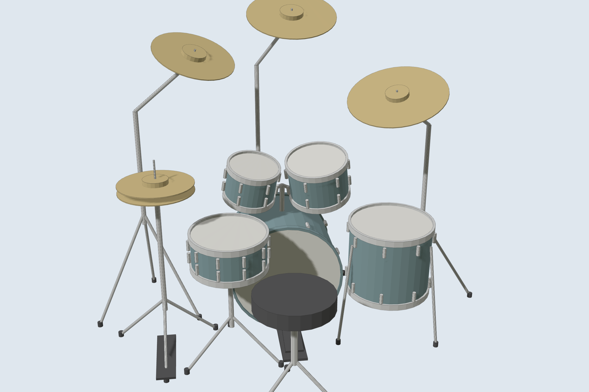
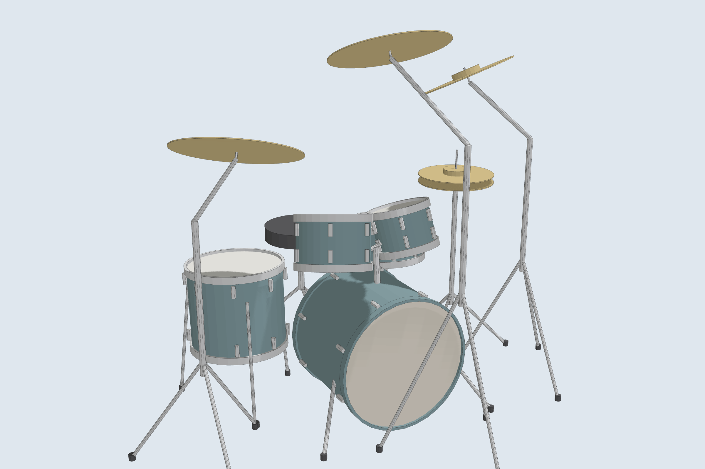
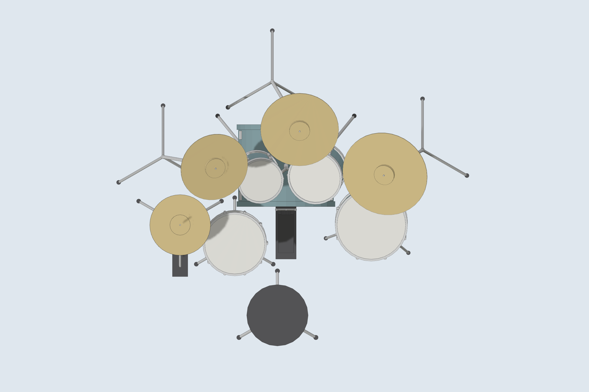

# Perkusja Mapex Mars MA529SF – model 3D

Model perkusji w rzeczywistych wymiarach, w tej samej skali i jednostkach (cm) co model domu,
żeby można ją było wstawić do domu.

| Widok od strony perkusisty | Z przodu | Z góry |
|---|---|---|
|  |  |  |

## Zestaw

* **Bębny (wymiary producenta, konfiguracja „Rock”)**: stopa 22×18", tomy 10×7" i 12×8"
  na stopie, floor tom 16×14" na nogach, werbel 14×6,5".
* **Statywy i talerze** ustawione jak na zdjęciu sklepu: hi-hat 14", crash 16" po lewej,
  crash 18" nad tomami, ride 20" po prawej. Rozmiary talerzy są typowe (sklep ich nie podaje).
* **Stołek perkusisty** – dodatkowo, do planowania miejsca (nie wchodzi w skład zestawu).
* Kolor korpusów dobrany ze zdjęcia (turkusowo-szary brokat).

**Zajmowane miejsce**: ok. **206 × 186 cm** razem ze stołkiem (bez stołka ok. 206 × 145 cm),
wysokość do najwyższego talerza ok. 164 cm.

## Pliki

| Plik | Do czego |
|---|---|
| `sketchup/perkusja.rb` | Skrypt dla SketchUpa – dodaje perkusję jako komponent do otwartego modelu. |
| `sketchup/perkusja.dae` | Import w SketchUpie (*Plik → Importuj*). |
| `inne_programy/perkusja.glb` | Blender / [3dviewer.net](https://3dviewer.net) – w metrach, jak plik domu. |
| `inne_programy/perkusja.obj` + `.mtl` | Inne programy (FreeCAD, Sweet Home 3D…). |

## Jak wstawić do domu

* **SketchUp**: otwórz model domu, *Okno → Konsola Ruby* i wpisz `load 'C:/ścieżka/do/perkusja.rb'`.
  Perkusja pojawi się na poziomie posadzki (z = 0). Na początku skryptu ustawisz miejsce:

  ```ruby
  @pozycja = [830, 640, 0]  # x, y w cm i obrót w stopniach – np. pokój 1 na parterze domu
  ```

  Domyślnie `[0, 0, 0]` (narożnik domu). Potem możesz ją przesunąć narzędziem *Przesuń (M)*
  i obrócić narzędziem *Obróć (Q)*. Opcje `@talerze`, `@statywy` i `@stolek` włączają
  lub wyłączają części zestawu, a tagi „Perkusja – …” pozwalają je ukryć.
* **Blender**: zaimportuj `dom_smart_comfort_*.glb`, a potem `perkusja.glb`
  (*File → Import → glTF 2.0*). Oba pliki są w metrach, więc skala się zgadza.
  Przesuń perkusję klawiszem **G**, obróć klawiszem **R**.

Układ komponentu: oś X w prawo (patrząc od miejsca perkusisty), oś Y do przodu (w stronę
przedniego naciągu stopy), punkt (0,0,0) na podłodze pod środkiem naciągu stopy od strony
perkusisty.

To model poglądowy: bez drobnych detali (śruby, sprężyny, logotypy).
