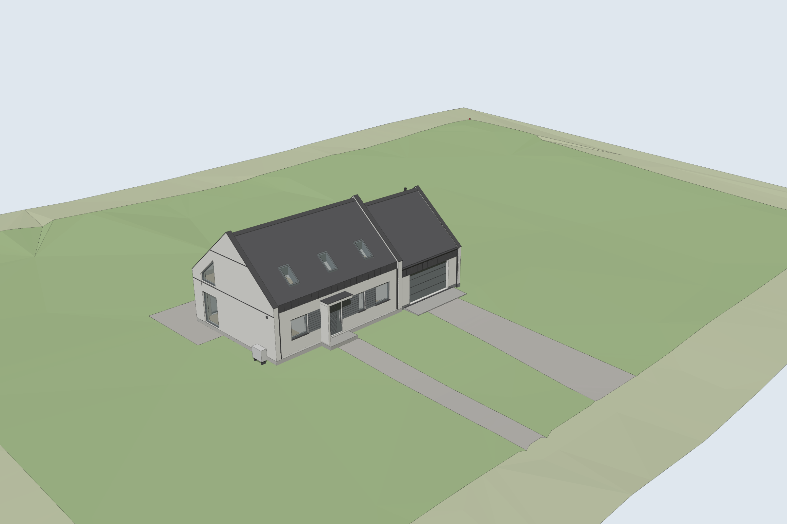
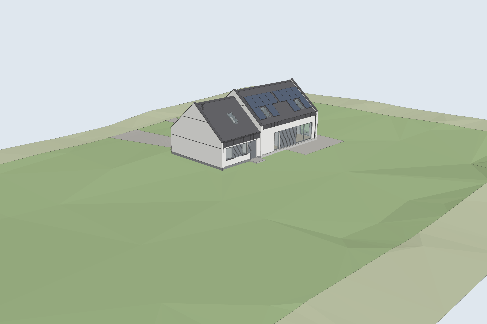
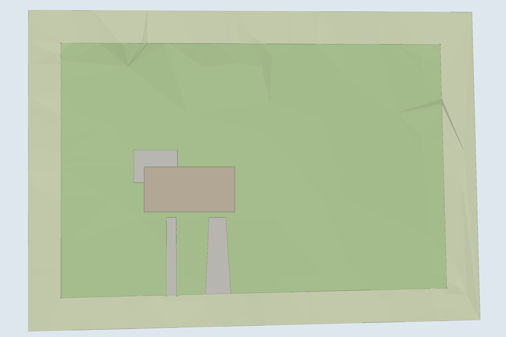

# Teren działki pod dom i garaż – model 3D

Model terenu zbudowany z **rzędnych wysokościowych z projektu zagospodarowania terenu**
(mapa do celów projektowych 1:500, układ wysokościowy PL-EVRF2007-NH), w tym samym układzie
i jednostkach (cm) co modele domu i garażu. Dom i garaż stoją dokładnie tam, gdzie na PZT.

| Od strony ogrodu | Teren z góry |
|---|---|
|  |  |

## Co jest w modelu

* **Powierzchnia terenu** z 75 pikiet wysokościowych z mapy (od ok. 60,5 do 64,1 m n.p.m.;
  teren podnosi się od drogi w głąb działki), pokazana na całej działce i 6 m wokół niej.
* **Strefy**: trawa na działce, otoczenie, utwardzenia (taras przy ścianie ogrodowej
  i przy oknie W1, dojście do wejścia ok. 1,8 m, podjazd do bramy garażu), grunt pod budynkami.
* **Platforma** wyrównana na poziomie terenu z projektu domu (−0,29) wokół budynków i pod tarasem.
* **Granica działki** ze znakami granicznymi i **warstwice co 0,5 m** (tylko w SketchUpie).

## Poziom ±0,00

PZT nie podaje rzędnej ±0,00 domu. Przyjęto **±0,00 = 62,46 m n.p.m.**, czyli średni teren
pod budynkami (62,17 m) + 0,29 m, tak jak na przekrojach domu (teren −0,29).
Jeśli projektant poda inną wartość, wpisz ją w `tools/teren_generuj.py` (`H0_RECZNIE = 62.50`)
i uruchom `tools/build.sh`.

## Pliki

| Plik | Do czego |
|---|---|
| `sketchup/teren.rb` | Skrypt dla SketchUpa (najlepiej wczytać do modelu domu). |
| `sketchup/teren.dae` | Import w SketchUpie. |
| `inne_programy/teren.glb` / `.obj` | Sam teren dla Blendera i innych programów. |
| `inne_programy/dom_garaz_teren_antracyt.glb` (i `_braz`) | **Wszystko razem**: dom + garaż + teren w jednym pliku – najprościej do Blendera albo [3dviewer.net](https://3dviewer.net). |
| `dane/rzedne_pzt.json` | Odczytane pikiety: x, y [m] w układzie domu, wysokość [m n.p.m.]. |

## Jak złożyć wszystko w SketchUpie

1. W skryptach `dom_smart_comfort.rb` i `garaz.rb` ustaw `@teren = false`
   (żeby nie było płaskiego trawnika), a w `garaz.rb` ustaw `@pozycja = [1066.5, 0]`.
2. W jednym modelu wczytaj kolejno w Konsoli Ruby: `dom_smart_comfort.rb`, `garaz.rb`, `teren.rb`
   (i ewentualnie `perkusja.rb`).

## Dokładność

* Położenie pikiet, granic i utwardzeń odczytane z rysunku w rozdzielczości 400 dpi
  (ok. ±0,3 m); wysokości dokładnie jak na mapie (co 0,1 m).
* Dom i garaż dopasowano do obrysu z PZT (osie ścian zgadzają się co do kilku cm).
* Między pikietami teren jest interpolowany liniowo, więc drobne nierówności, których nie
  pomierzono, nie są widoczne.
